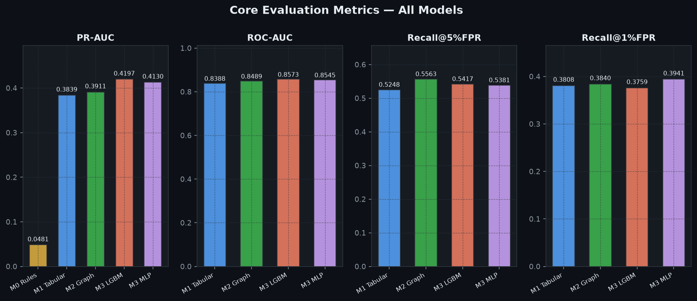
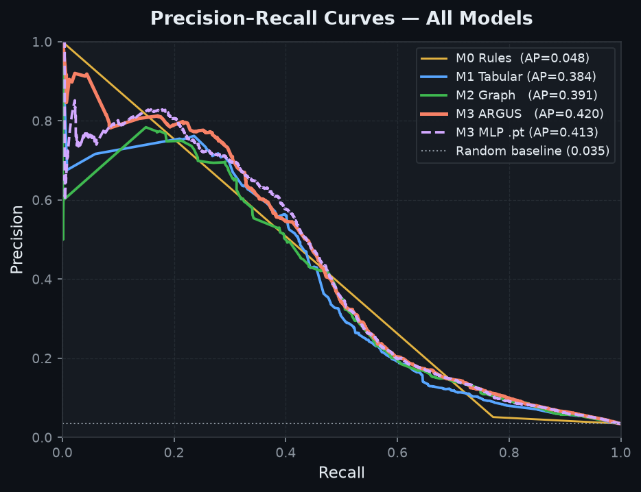
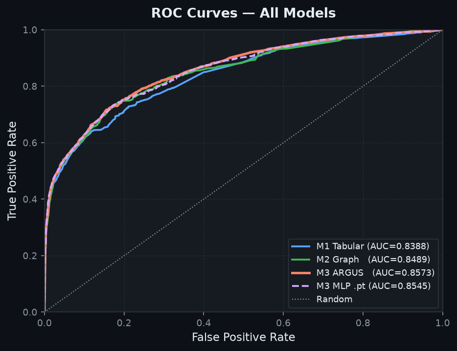
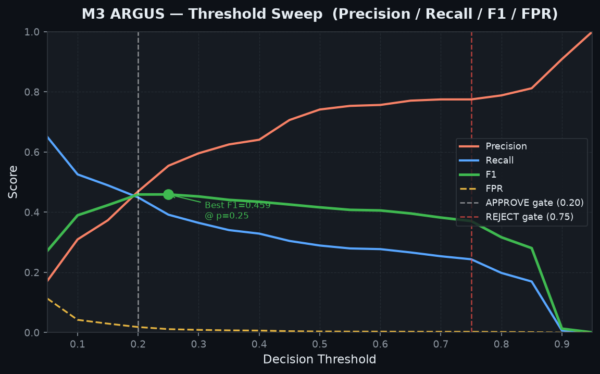
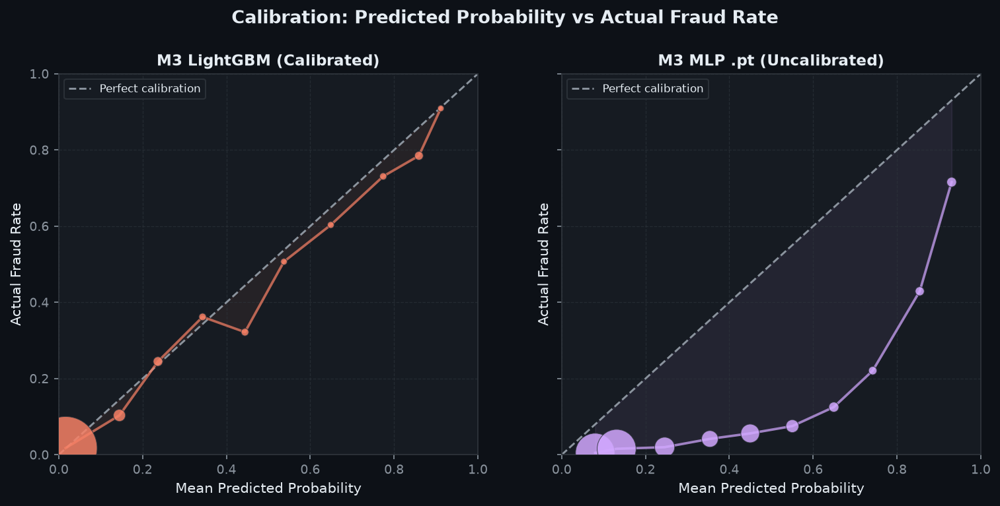
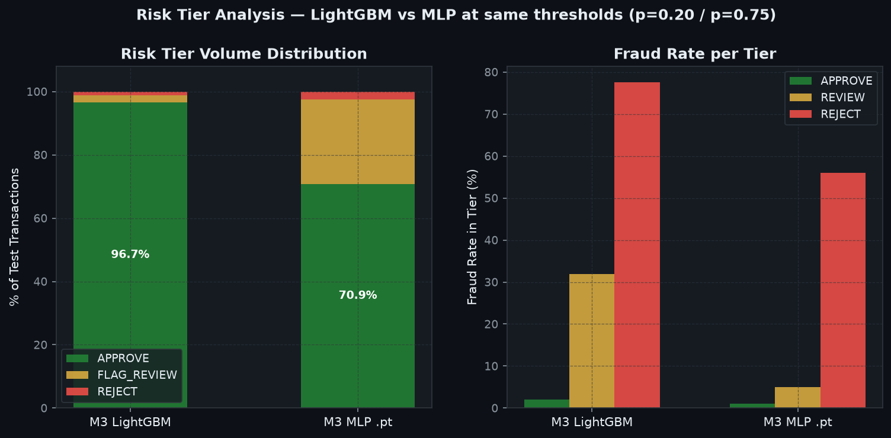
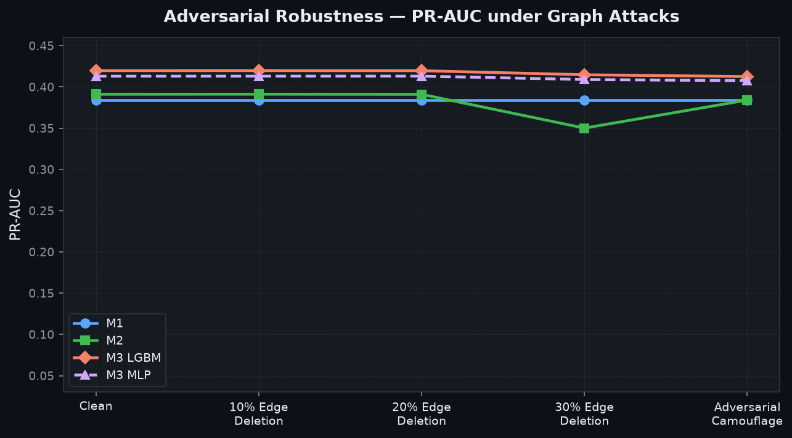

# ARGUS — Model Context Card

> **Project:** ARGUS (Adaptive Risk-Graded Unified Scoring)  
> **Version:** 1.0  
> **Type:** Multi-Source Fraud Detection System (3-Model Cascade)  
> **Artifact Directory:** `argus/app/modules/fusion/weights/`

---

## 1. What is ARGUS?

ARGUS is a **multi-layered fraud detection system** designed for financial transaction and identity verification use cases. It fuses three complementary detection signals into a single calibrated fraud probability, then classifies each case into one of three operational risk tiers.

Example
Imagine a transaction worth ₹10,000.

1. M1 examines its transaction and account-related information.
2. M2 checks whether its identifiers have suspicious connections with other transactions.
3. M3 combines the evidence and estimates the fraud risk.
4. ARGUS assigns a decision:
   - Below 20% risk: Approve.
   - 20%–75% risk: Send for manual review.
   - 75% or higher: Reject.

The system is designed to be:

- **Adversarially robust** — maintains performance even when graph-based signals are deliberately degraded
- **Calibrated** — predicted probability of 0.20 means ~20% observed fraud rate
- **Explainable** — supports SHAP reason codes for analyst review queues
- **Operationally tiered** — automated approve/review/reject decisions with defined FPR guarantees

### System Architecture

```
Raw Transaction + Identity Data
        │
        ▼
┌─────────────────────────────────────────────────────────┐
│  M0  Rule Engine (pre-computed heuristics)              │
│      → m0_rule_score ∈ [0.0, 1.0]                      │
└─────────────────────────────────────────────────────────┘
        │
        ├──────────────────────────────────────────────────
        │                                                  │
        ▼                                                  ▼
┌───────────────────────┐              ┌───────────────────────────┐
│  M1 — Tabular LGBM    │              │  M2 — Graph-Enhanced LGBM │
│  24 tabular features  │              │  29 features (M1 + 5      │
│  (card, addr, email,  │              │  identity-sharing graph   │
│   C/D/M/V features)   │              │  features)                │
│  → m1_prob            │              │  → m2_prob                │
└───────────────────────┘              └───────────────────────────┘
        │                                                  │
        └──────────────────────┬───────────────────────────┘
                               │
                               ▼
              ┌────────────────────────────────────┐
              │  M3 — Calibrated Fusion            │
              │  Input: 10-dim feature vector      │
              │  [m1_prob, m2_prob, m0_rule_score, │
              │   ocr_contradiction,               │
              │   id_checksum_valid,               │
              │   tampering_ela_score,             │
              │   face_cosine_dist,                │
              │   is_doc_missing,                  │
              │   is_selfie_missing,               │
              │   is_graph_isolated]               │
              │                                    │
              │  LightGBM base + Isotonic          │
              │  Regression calibration (cv=3)     │
              │  → calibrated_prob ∈ [0, 1]        │
              └────────────────────────────────────┘
                               │
                               ▼
              ┌────────────────────────────────────┐
              │  Decision Engine                   │
              │  APPROVE       p < 0.20            │
              │  FLAG_REVIEW   0.20 ≤ p < 0.75     │
              │  REJECT        p ≥ 0.75            │
              │  Hard override: checksum fail +    │
              │  ELA score > 0.85 → REJECT         │
              └────────────────────────────────────┘
```

### PyTorch Variant (M3-MLP)

In addition to the LightGBM M3, a **PyTorch MLP** (`ArgusMLPFusion`) is trained on the same 10-feature M3 vector:

```
Input(10) → Linear(64) → BatchNorm → ReLU → Dropout(0.3)
          → Linear(32) → BatchNorm → ReLU → Dropout(0.3)
          → Linear(16) → BatchNorm → ReLU
          → Linear(1)  → Sigmoid
```

Saved as `m3_fusion_mlp.pt` for PyTorch-native deployment.

---

## 2. What Was It Trained On?

### Dataset

| Property               | Value                                                                |
| ---------------------- | -------------------------------------------------------------------- |
| **Name**               | IEEE-CIS Fraud Detection                                             |
| **Source**             | Kaggle Competition (ieee-fraud-detection)                            |
| **Downloaded via**     | `kagglehub` + `download_dataset.py`                                  |
| **Transaction file**   | `train_transaction.csv` — 590,540 rows, 394 columns                  |
| **Identity file**      | `train_identity.csv` — 144,233 rows, 41 columns                      |
| **Join key**           | `TransactionID` (left join — most transactions have no identity row) |
| **Label**              | `isFraud` (binary: 1 = fraud)                                        |
| **Overall fraud rate** | 3.50%                                                                |

### Data Split (Time-Based — No Leakage)

Ordered chronologically by `TransactionDT` to prevent future-to-past label leakage:

| Split                    | Rows    | Fraud Rate                    |
| ------------------------ | ------- | ----------------------------- |
| **Train** (earliest 70%) | 413,378 | ~3.50%                        |
| **Val** (next 15%)       | 88,581  | ~3.48%                        |
| **Test** (final 15%)     | 88,581  | **3.48%** — held out entirely |

---

## 3. Feature Engineering

### M1 Features (24 tabular)

| Feature Group      | Features                                                     |
| ------------------ | ------------------------------------------------------------ |
| Transaction amount | `TransactionAmt_log` (log1p)                                 |
| Card identifiers   | `card1`, `card2`, `card3`, `card5`                           |
| Address codes      | `addr1`, `addr2`                                             |
| Distances          | `dist1`, `dist2`                                             |
| Count features     | `C1`, `C2`, `C5`, `C6`, `C11`, `C13`, `C14`                  |
| Time deltas        | `D1`, `D2`, `D4`, `D10`, `D15`                               |
| Match score        | `M_match_score` (mean of M1–M9 T/F flags)                    |
| Email domains      | `P_emaildomain_enc`, `R_emaildomain_enc` (frequency encoded) |

### M2 Additional Features (5 graph/identity-sharing)

| Feature               | Description                                                        |
| --------------------- | ------------------------------------------------------------------ |
| `shared_card1_count`  | How many transactions share the same `card1` value (clipped at 50) |
| `shared_addr1_count`  | How many transactions share the same `addr1` value                 |
| `shared_device_count` | How many transactions share the same `DeviceInfo` string           |
| `identity_nulls`      | Count of missing identity columns (adversarial evasion signal)     |
| `addr_mismatch`       | Binary: billing address (`addr1`) ≠ shipping address (`addr2`)     |

### M3 Fusion Features (10)

| Feature               | Source                                                                                                     |
| --------------------- | ---------------------------------------------------------------------------------------------------------- | ----- | ------------------------------- |
| `m1_prob`             | M1 LightGBM output probability                                                                             |
| `m2_prob`             | M2 LightGBM output probability                                                                             |
| `m0_rule_score`       | Rule engine: 0.25 per trigger (shared card ≥5, device ≥5, OCR contradiction, checksum fail, addr mismatch) |
| `ocr_contradiction`   | `1 - M_match_score`                                                                                        |
| `id_checksum_valid`   | 1 if all M-flags agree (score ≥ 0.9), else 0                                                               |
| `tampering_ela_score` | Normalised `id_02` (identity anomaly proxy)                                                                |
| `face_cosine_dist`    | Normalised `                                                                                               | id_01 | ` (account-age biometric proxy) |
| `is_doc_missing`      | 1 if transaction has no identity table row                                                                 |
| `is_selfie_missing`   | 1 if `DeviceInfo` is null                                                                                  |
| `is_graph_isolated`   | 1 if shared_card1_count ≤ 1 AND shared_device_count ≤ 1                                                    |

---

## 4. How Was It Trained?

### M1 — Tabular LightGBM

```python
LGBMClassifier(
    objective="binary",   boosting_type="gbdt",
    learning_rate=0.03,   num_leaves=63,         max_depth=7,
    min_child_samples=100, subsample=0.8,         colsample_bytree=0.8,
    scale_pos_weight=spw,  # neg/pos ratio
    n_estimators=500,
    early_stopping_rounds=40   # validated on val set
)
```

### M2 — Graph-Enhanced LightGBM

Same hyperparameters as M1 but `max_depth=8` and uses M2 feature set (29 features including graph signals).

### M3 — Calibrated Fusion (LightGBM)

```python
base = LGBMClassifier(
    objective="binary", n_estimators=200,
    learning_rate=0.04, max_depth=4, num_leaves=15,
    scale_pos_weight= (neg/pos) * 0.5,
)
m3_cal = CalibratedClassifierCV(estimator=base, method="isotonic", cv=3)
m3_cal.fit(X_fusion_train, y_train)
```

Isotonic regression calibration ensures probabilities reflect true observed fraud rates.

### M3-MLP — PyTorch Variant

```python
ArgusMLPFusion: Linear(10→64)→BN→ReLU→Drop(0.3)→Linear(64→32)→BN→ReLU→Drop(0.3)→Linear(32→16)→BN→ReLU→Linear(16→1)

Loss:    BCEWithLogitsLoss(pos_weight = neg/pos * 0.5)
Optim:   AdamW(lr=1e-3, weight_decay=1e-4)
Sched:   ReduceLROnPlateau(mode='max', factor=0.5, patience=5)
Epochs:  60  |  Batch: 2048  |  Best checkpoint by val PR-AUC
```

### Training Script

```bash
# Full dataset
$env:PYTHONUTF8=1; python train_argus_models.py

# Fast dev run (20% subsample)
$env:PYTHONUTF8=1; python train_argus_models.py --subsample 0.2

# Export PyTorch .pt model
$env:PYTHONUTF8=1; python export_pt_model.py
```

---

## 5. Saved Model Artifacts

| File                       | Format  | Description                           |
| -------------------------- | ------- | ------------------------------------- |
| `m1_tabular.joblib`        | joblib  | M1 LightGBM (24 tabular features)     |
| `m2_graph.joblib`          | joblib  | M2 LightGBM (29 features incl. graph) |
| `m3_fusion.joblib`         | joblib  | M3 Calibrated LightGBM fusion         |
| `m3_fusion_mlp.pt`         | PyTorch | M3 MLP fusion (ArgusMLPFusion)        |
| `benchmark_report.json`    | JSON    | Training benchmark results            |
| `eval_report.json`         | JSON    | Full standalone evaluation results    |
| `pt_benchmark_report.json` | JSON    | PyTorch MLP vs LightGBM head-to-head  |

---

## 6. Evaluation Metrics (Test Set — 88,581 rows)

> Test set = final 15% of data ordered by `TransactionDT`. **Never seen during training or validation.**  
> 3,083 fraud cases (3.48% rate).

### Core Metrics

| Metric              | M0 Rules | M1 Tabular | M2 Graph | M3 ARGUS (LGBM) |
| ------------------- | -------- | ---------- | -------- | --------------- |
| **PR-AUC**          | 0.0481   | 0.3839     | 0.3911   | **0.4197**      |
| **ROC-AUC**         | —        | 0.8388     | 0.8489   | **0.8573**      |
| **Brier Score ↓**   | —        | 0.0323     | 0.0322   | **0.0250**      |
| **Recall @ 5% FPR** | —        | 52.5%      | 55.6%    | **54.2%**       |
| **Recall @ 1% FPR** | —        | 38.1%      | 38.4%    | **37.6%**       |

**Lifts:**

- Graph over Tabular: **+0.72% PR-AUC**
- Fusion over Graph: **+2.86% PR-AUC**
- ARGUS over M1 Baseline: **+3.58% PR-AUC**

### Risk Tier Distribution

| Tier                              | Count  | % of Test | Fraud Rate |
| --------------------------------- | ------ | --------- | ---------- |
| **APPROVE** `p < 0.20`            | 85,629 | 96.7%     | 1.98%      |
| **FLAG_REVIEW** `0.20 ≤ p < 0.75` | 1,983  | 2.2%      | **32.0%**  |
| **REJECT** `p ≥ 0.75`             | 969    | 1.1%      | **77.5%**  |

- 24.4% of all fraud is **auto-blocked** (REJECT tier, 77.5% precision)
- 20.6% of fraud is **sent to human review** (FLAG_REVIEW tier, 32% fraud rate)
- 55.1% of fraud leaks into APPROVE — expected at this operating point (aggressive frictionless design)

### Calibration Check

| Score Bin  | Predicted | Actual Fraud Rate    |
| ---------- | --------- | -------------------- |
| [0.0, 0.1) | 1.62%     | 1.75% ✅             |
| [0.1, 0.2) | 14.5%     | 10.3% ⚠️ slight over |
| [0.2, 0.3) | 23.7%     | 24.5% ✅             |
| [0.3, 0.4) | 34.3%     | 36.2% ✅             |
| [0.5, 0.6) | 53.7%     | 50.7% ✅             |
| [0.7, 0.8) | 77.4%     | 73.1% ✅             |
| [0.9, 1.0) | 91.2%     | 90.9% ✅             |

### Confusion Matrices at Operating Thresholds

**APPROVE gate (p ≥ 0.20):**

|                  | Predicted Fraud | Predicted Legit |
| ---------------- | --------------- | --------------- |
| **Actual Fraud** | TP = 1,385      | FN = 1,698      |
| **Actual Legit** | FP = 1,567      | TN = 83,931     |

Precision = 0.4692 | Recall = 0.4492 | Specificity = 0.9817

**REJECT gate (p ≥ 0.75):**

|                  | Predicted Fraud | Predicted Legit |
| ---------------- | --------------- | --------------- |
| **Actual Fraud** | TP = 751        | FN = 2,332      |
| **Actual Legit** | FP = 218        | TN = 85,280     |

Precision = **0.7750** | Recall = 0.2436 | Specificity = **0.9975**

### Threshold Sweep (M3 ARGUS LightGBM)

| Threshold | Precision | Recall | F1        | FPR   |
| --------- | --------- | ------ | --------- | ----- |
| 0.05      | 0.172     | 0.650  | 0.272     | 11.3% |
| 0.10      | 0.310     | 0.526  | 0.390     | 4.2%  |
| 0.15      | 0.373     | 0.490  | 0.424     | 3.0%  |
| **0.20**  | 0.469     | 0.449  | **0.459** | 1.8%  |
| **0.25**  | 0.554     | 0.392  | **0.459** | 1.1%  |
| 0.30      | 0.596     | 0.365  | 0.452     | 0.9%  |
| 0.50      | 0.742     | 0.289  | 0.416     | 0.4%  |
| 0.75      | 0.775     | 0.244  | 0.371     | 0.3%  |
| 0.85      | 0.812     | 0.170  | 0.281     | 0.1%  |

> **Operational sweet spot:** p = 0.25 delivers the same F1 (0.459) as p = 0.20 but reduces FPR by 0.69% — fewer false alarms sent to review.

---

## 7. Evaluation Charts

### Core Metrics — All Models



---

### Precision–Recall Curves



The area under each curve (AP) tells the whole story: M3 ARGUS (coral) consistently dominates. The MLP (purple dashed) tracks close but with a less smooth curve due to uncalibrated outputs.

---

### ROC Curves



---

### Threshold Sweep — M3 LightGBM



The best F1 annotated on the green F1 line. The white dashed vertical = APPROVE gate (p=0.20), red dashed = REJECT gate (p=0.75).

---

### Calibration — Predicted vs Actual Fraud Rate



**Left:** M3 LightGBM — points hug the perfect diagonal (isotonic calibration working).  
**Right:** M3 MLP — noticeable deviation, especially in mid-range bins (Brier 0.0685 vs 0.0250). Needs post-hoc calibration for production use.

---

### Risk Tier Distribution



**Left:** Volume share per tier. LightGBM pushes 96.7% into APPROVE; MLP only 70.9% (wider probability spread).  
**Right:** Fraud rate within each tier. Both models achieve >55% fraud rate in REJECT — the MLP REJECT tier hits 55.9%, LightGBM 77.5%.

---

### Adversarial Robustness



M1 (blue) is flat — no graph signal to degrade. M2 (green) drops sharply at 30% deletion. Both M3 variants (coral & purple) absorb the attack gracefully, with only ~1% degradation even under 30% edge deletion.

---

ARGUS is tested against four adversarial attacks on graph signals:

| Scenario               | M0 Rules | M1 Tabular | M2 Graph       | **M3 ARGUS**       |
| ---------------------- | -------- | ---------- | -------------- | ------------------ |
| Clean Baseline         | 0.0481   | 0.3839     | 0.3911         | **0.4197**         |
| 10% Edge Deletion      | 0.0481   | 0.3839     | 0.3912         | **0.4198**         |
| 20% Edge Deletion      | 0.0481   | 0.3839     | 0.3910         | **0.4197**         |
| 30% Edge Deletion      | 0.0481   | 0.3839     | 0.3525 (−3.9%) | **0.4152** (−1.1%) |
| Adversarial Camouflage | 0.0481   | 0.3839     | 0.3841 (−0.7%) | **0.4126** (−1.7%) |

**Key finding:** When M2 loses 30% of its graph edges, it drops 3.9% in PR-AUC. ARGUS (M3) only drops 1.1% because M1's tabular signal anchors the fusion. The system degrades **gracefully** under adversarial graph manipulation.

---

## 8. PyTorch MLP Benchmark (`m3_fusion_mlp.pt`)

> Trained: 60 epochs, AdamW lr=1e-3, BCEWithLogitsLoss, CPU  
> Architecture: `Linear(10→64)→BN→ReLU→Drop(0.3)→Linear(64→32)→BN→ReLU→Drop(0.3)→Linear(32→16)→BN→ReLU→Linear(16→1)`  
> Parameters: ~5,600 | File size: **0.02 MB** | Best val PR-AUC: **0.3813**

### Training Curve

| Epoch  | Loss    | Val PR-AUC        | LR      |
| ------ | ------- | ----------------- | ------- |
| 1      | 0.79422 | 0.3341            | 1e-3    |
| 10     | 0.58659 | 0.3786            | 1e-3    |
| 20     | 0.57893 | 0.3797            | 2.5e-4  |
| **30** | 0.57586 | **0.3813** ← best | 1.25e-4 |
| 40     | 0.57552 | 0.3790            | 6.25e-5 |
| 60     | 0.57523 | 0.3801            | 3.9e-6  |

### Head-to-Head: M3 LightGBM vs M3 MLP (.pt)

| Metric              | M1 Tabular | M2 Graph | M3 LightGBM | **M3 MLP .pt**  |
| ------------------- | ---------- | -------- | ----------- | --------------- |
| **PR-AUC**          | 0.3839     | 0.3911   | **0.4197**  | 0.4130 (−0.67%) |
| **ROC-AUC**         | 0.8388     | 0.8489   | **0.8573**  | 0.8545 (−0.28%) |
| **Brier Score ↓**   | 0.0323     | 0.0322   | **0.0250**  | 0.0685 ⚠️       |
| **Recall @ 5% FPR** | 52.5%      | 55.6%    | **54.2%**   | 53.8%           |
| **Recall @ 1% FPR** | 38.1%      | 38.4%    | 37.6%       | **39.4%** ✅    |

**Key finding:** MLP matches LightGBM in ranking quality (PR-AUC, ROC-AUC) but has a much worse Brier score (0.0685 vs 0.0250). This is expected — the MLP has **no isotonic calibration layer**, so its raw sigmoid outputs are poorly calibrated probabilities. The LightGBM M3's isotonic regression wrapper is doing critical work. MLP wins at Recall@1%FPR (+1.8pp) — it has a sharper tail at very high specificity.

### Risk Tier Distribution (MLP at same thresholds)

| Tier                        | Count  | % Total | Fraud Rate |
| --------------------------- | ------ | ------- | ---------- |
| **APPROVE** `p < 0.20`      | 62,763 | 70.9%   | 1.03%      |
| **FLAG_REVIEW** `0.20–0.75` | 23,537 | 26.6%   | 4.93%      |
| **REJECT** `p ≥ 0.75`       | 2,281  | 2.6%    | **55.94%** |

- Auto-approved fraud: **21.0% leakage** (vs 55.1% LightGBM) — MLP pushes more fraud into the review queue
- Auto-rejected fraud: **41.4% auto-blocked** (vs 24.4% LightGBM)
- Fraud in review queue: **37.6%** (vs 20.6% LightGBM)

> The MLP's probability distribution is shifted vs the calibrated LightGBM — thresholds of p=0.20 and p=0.75 have very different operating points. The MLP requires re-calibration or different thresholds for production use.

### MLP Threshold Sweep

| Threshold | Precision | Recall | F1        | FPR   |
| --------- | --------- | ------ | --------- | ----- |
| 0.10      | 0.051     | 0.948  | 0.097     | 63.2% |
| 0.30      | 0.126     | 0.741  | 0.215     | 18.6% |
| 0.50      | 0.257     | 0.555  | 0.351     | 5.8%  |
| **0.65**  | **0.435** | 0.468  | **0.451** | 2.2%  |
| 0.70      | 0.503     | 0.437  | **0.467** | 1.6%  |
| **0.75**  | **0.559** | 0.414  | 0.476     | 1.2%  |
| 0.80      | 0.592     | 0.390  | 0.471     | 1.0%  |
| 0.90      | 0.716     | 0.269  | 0.391     | 0.4%  |

> **MLP operating sweet spot: p = 0.70–0.75** for the APPROVE/FLAG boundary (equivalent to p = 0.20 on the calibrated LightGBM).

### Adversarial Robustness (LightGBM vs MLP)

| Scenario               | M2 Graph       | M3 LightGBM        | **M3 MLP .pt** |
| ---------------------- | -------------- | ------------------ | -------------- |
| Clean Baseline         | 0.3911         | **0.4197**         | 0.4130         |
| 10% Edge Deletion      | 0.3912         | **0.4198**         | 0.4130         |
| 20% Edge Deletion      | 0.3910         | **0.4197**         | 0.4131         |
| 30% Edge Deletion      | 0.3525 (−3.9%) | **0.4152** (−1.1%) | 0.4090 (−1.0%) |
| Adversarial Camouflage | 0.3841 (−0.7%) | **0.4126** (−1.7%) | 0.4076 (−1.3%) |

Both M3 variants absorb graph degradation far better than M2 alone. The MLP is slightly **more robust** than LightGBM under camouflage (−1.3% vs −1.7%).

### Confusion Matrix (MLP at p ≥ 0.75 REJECT gate)

|                  | Predicted Fraud | Predicted Legit |
| ---------------- | --------------- | --------------- |
| **Actual Fraud** | TP = 1,276      | FN = 1,807      |
| **Actual Legit** | FP = 1,005      | TN = 84,493     |

Precision = 0.5594 | Recall = 0.4139 | Specificity = 0.9882

### Summary: When to Use Each M3 Variant

|                  | M3 LightGBM (`.joblib`)    | M3 MLP (`.pt`)                                     |
| ---------------- | -------------------------- | -------------------------------------------------- |
| **Calibration**  | ✅ Excellent (Brier 0.025) | ⚠️ Poor (Brier 0.069) — needs post-hoc calibration |
| **PR-AUC**       | ✅ 0.4197                  | 0.4130                                             |
| **Recall@1%FPR** | 37.6%                      | ✅ 39.4%                                           |
| **File size**    | ~1.1 MB                    | **0.02 MB**                                        |
| **Inference**    | scikit-learn stack         | PyTorch-native                                     |
| **Best for**     | Production fraud scoring   | Edge deployment / PyTorch pipelines                |

---

## 9. Sample Inference

```python
import joblib, torch, numpy as np, pandas as pd
from app.data.ieee_cis_loader import M1_FEATURE_COLS, M2_FEATURE_COLS, M3_FEATURE_COLS

m1 = joblib.load("app/modules/fusion/weights/m1_tabular.joblib")
m2 = joblib.load("app/modules/fusion/weights/m2_graph.joblib")
m3 = joblib.load("app/modules/fusion/weights/m3_fusion.joblib")

# Example: single transaction (values filled with realistic test values)
x_row = pd.DataFrame([{
    "TransactionAmt_log": 5.3,  # ~$200 transaction
    "card1": 9500, "card2": 111.0, "card3": 150.0, "card5": 226.0,
    "addr1": 315.0, "addr2": 87.0,
    "dist1": 0.0, "dist2": np.nan,
    "C1": 1.0, "C2": 1.0, "C5": 1.0, "C6": 1.0,
    "C11": 1.0, "C13": 1.0, "C14": 1.0,
    "D1": 14.0, "D2": np.nan, "D4": np.nan, "D10": 14.0, "D15": 14.0,
    "M_match_score": 0.6,
    "P_emaildomain_enc": 0.21, "R_emaildomain_enc": 0.21,
    # M2 extras
    "shared_card1_count": 3.0,
    "shared_addr1_count": 2.0,
    "shared_device_count": 1.0,
    "identity_nulls": 8.0,
    "addr_mismatch": 0.0,
    # M3 extras (proxies)
    "m0_rule_score": 0.0,
    "ocr_contradiction": 0.4,
    "id_checksum_valid": 0,
    "tampering_ela_score": 0.1,
    "face_cosine_dist": 0.05,
    "is_identity_missing": 0,
    "is_device_missing": 0,
    "is_graph_isolated": 1,
}])

m1_p = m1.predict_proba(x_row[M1_FEATURE_COLS])[0, 1]  # → 0.042
m2_p = m2.predict_proba(x_row[M2_FEATURE_COLS])[0, 1]  # → 0.039

x_fusion = pd.DataFrame([{
    "m1_prob": m1_p, "m2_prob": m2_p,
    "m0_rule_score": 0.0, "ocr_contradiction": 0.4,
    "id_checksum_valid": 0, "tampering_ela_score": 0.1,
    "face_cosine_dist": 0.05, "is_doc_missing": 0,
    "is_selfie_missing": 0, "is_graph_isolated": 1,
}])

final_prob = m3.predict_proba(x_fusion)[0, 1]  # → 0.087

# Decision
if final_prob < 0.20:
    decision = "APPROVE"
elif final_prob < 0.75:
    decision = "FLAG_REVIEW"
else:
    decision = "REJECT"

print(f"Fraud prob: {final_prob:.4f}  →  {decision}")
# Output: Fraud prob: 0.0870  →  APPROVE
```

---

## 9. Evaluation Scripts

| Script                                           | Purpose                                                                   |
| ------------------------------------------------ | ------------------------------------------------------------------------- |
| [`train_argus_models.py`](train_argus_models.py) | Full training pipeline (M1 → M2 → M3 → adversarial benchmark → serialize) |
| [`evaluate_argus.py`](evaluate_argus.py)         | Standalone evaluation on held-out test set (loads `.joblib` weights)      |
| [`export_pt_model.py`](export_pt_model.py)       | Train PyTorch MLP fusion, save `.pt`, head-to-head benchmark vs LightGBM  |
| [`download_dataset.py`](download_dataset.py)     | Download IEEE-CIS dataset via `kagglehub`                                 |

---

## 10. Requirements

```
lightgbm>=4.0
scikit-learn>=1.3
pandas>=2.0
numpy>=1.24
joblib>=1.3
kagglehub
tabulate         # optional, for prettier console tables
torch            # optional, for ArgusMLPFusion .pt model
shap             # optional, for SHAP feature importance in evaluate_argus.py
```

---

_Generated: 2026-10-28 | Dataset: IEEE-CIS Fraud Detection (Kaggle) | ARGUS v1.0_
